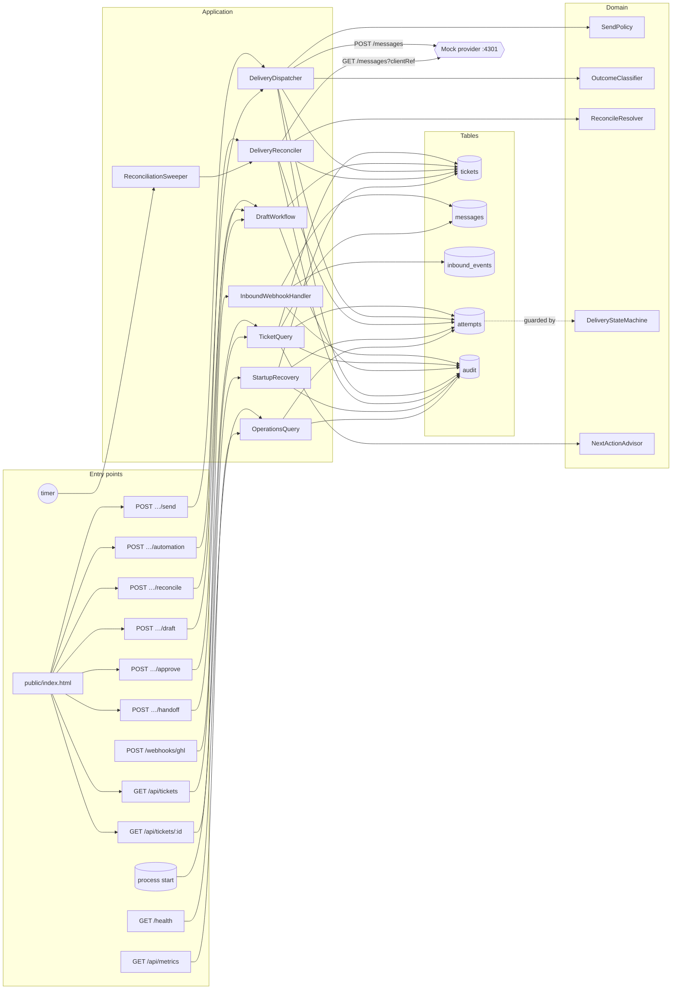

# Blast radius (cartographer)

Every public entry point of the application, what it reaches, which tables it touches, and the scenario
that proves it in the before/after battery (`scripts/before-after/scenarios.mjs`). Generated module
graph: [`module-graph.md`](module-graph.md).

## Entry point table

| Entry point | Changes behaviour? | Why | Confidence | Proven by |
|---|---|---|---|---|
| `POST /webhooks/ghl` | yes | idempotent per (tenant, event), atomic with message + audit, constant-time secret | sure | S01, S02, S03, R1 tests, http test |
| `GET /api/tickets` | additive | still tenant-scoped; no field removed | sure | R2 tests |
| `GET /api/tickets/:id` | yes | tenant-scoped (404 cross-tenant); adds `nextAction`, `approved`, attempt/audit fields | sure | S04, S13, R6 tests |
| `POST …/draft` | yes | tenant-scoped; invalidates approval; length-limited | sure | S04, S05, R3 tests |
| `POST …/approve` | yes | binds approval to the current version (compare-and-set) | sure | S05, R3 tests |
| `POST …/handoff` | yes | tenant-scoped; audited | sure | S04, S12, R5 tests |
| `POST …/send` | yes | outbox reservation, policy, outcome classification, no auto-retry | sure | S05–S11, R3/R4 tests |
| `POST …/automation` | yes | same path as send + takeover rule + approval | sure | S12, R5 tests |
| `POST …/reconcile` | yes | was 501; now provider evidence by clientRef | sure | S09, S11, R4 tests |
| process start | yes | migrations 1–5, recovery of PENDING attempts to UNKNOWN | sure | S08, S11, migration test |
| `GET /` (inbox) | yes | renders next action, attempts and audit with `textContent` only | sure | S13, security test |
| mock provider | no | untouched by design | sure | identical behaviour both sides |
| `GET /health` | new | database ping + reconciler status | sure | S14, operations tests |
| `GET /api/metrics` | new | tenant-scoped counters | sure | S14, operations tests |
| reconciler timer | new | looks up `UNKNOWN` attempts with backoff + jitter, never resends | sure | S15, operations tests |
| SIGTERM / SIGINT | yes | drain in-flight sends and the reconciler run before closing | sure | operations tests |
| `npm run event` | no | still posts the same fixture event; replays are now idempotent | sure | S01 |

## Shared-table coupling
`attempts` is written by four writers (dispatcher settle, operator reconcile, background reconciler, startup recovery). All four use
compare-and-set transitions (`WHERE id = ? AND state = ?`) validated by `DeliveryStateMachine`, so the
first writer wins and the others record `settlement_skipped` / `reconcile_inconclusive` instead of
overwriting. `tickets.send_state` is only updated when the attempt's version is still the current draft
version, and the read model overlays any unresolved attempt so an UNKNOWN can never be hidden by an edit.
