# Module graph (generated by `npm run graph`)

Dependencies point inward: http → application → domain, with infrastructure behind repositories and config shared.

```mermaid
flowchart LR
  subgraph config
    config_config_mjs["config/config.mjs"]
    config_constants_mjs["config/constants.mjs"]
    config_fixtures_mjs["config/fixtures.mjs"]
  end
  subgraph domain
    domain_delivery_state_machine_mjs["domain/delivery-state-machine.mjs"]
    domain_errors_mjs["domain/errors.mjs"]
    domain_next_action_advisor_mjs["domain/next-action-advisor.mjs"]
    domain_outcome_classifier_mjs["domain/outcome-classifier.mjs"]
    domain_reconcile_resolver_mjs["domain/reconcile-resolver.mjs"]
    domain_send_policy_mjs["domain/send-policy.mjs"]
  end
  subgraph infrastructure
    infrastructure_database_mjs["infrastructure/database.mjs"]
    infrastructure_field_cipher_mjs["infrastructure/field-cipher.mjs"]
    infrastructure_logger_mjs["infrastructure/logger.mjs"]
    infrastructure_migrations_mjs["infrastructure/migrations.mjs"]
    infrastructure_persistence_factory_mjs["infrastructure/persistence-factory.mjs"]
    infrastructure_repositories_mjs["infrastructure/repositories.mjs"]
    infrastructure_sql_mjs["infrastructure/sql.mjs"]
  end
  subgraph application
    application_delivery_dispatcher_mjs["application/delivery-dispatcher.mjs"]
    application_delivery_reconciler_mjs["application/delivery-reconciler.mjs"]
    application_draft_workflow_mjs["application/draft-workflow.mjs"]
    application_inbound_webhook_handler_mjs["application/inbound-webhook-handler.mjs"]
    application_operations_query_mjs["application/operations-query.mjs"]
    application_reconciliation_sweeper_mjs["application/reconciliation-sweeper.mjs"]
    application_startup_recovery_mjs["application/startup-recovery.mjs"]
    application_support_mjs["application/support.mjs"]
    application_ticket_query_mjs["application/ticket-query.mjs"]
  end
  subgraph http
    http_auth_mjs["http/auth.mjs"]
    http_http_io_mjs["http/http-io.mjs"]
    http_router_mjs["http/router.mjs"]
  end
  subgraph entry
    mock_provider_mjs["mock-provider.mjs"]
    provider_client_mjs["provider-client.mjs"]
    replay_event_mjs["replay-event.mjs"]
    server_mjs["server.mjs"]
    service_mjs["service.mjs"]
    store_mjs["store.mjs"]
  end
  application_delivery_dispatcher_mjs --> config_constants_mjs
  application_delivery_dispatcher_mjs --> domain_errors_mjs
  application_delivery_dispatcher_mjs --> infrastructure_database_mjs
  application_delivery_dispatcher_mjs --> application_support_mjs
  application_delivery_reconciler_mjs --> config_constants_mjs
  application_delivery_reconciler_mjs --> domain_errors_mjs
  application_delivery_reconciler_mjs --> application_support_mjs
  application_draft_workflow_mjs --> config_constants_mjs
  application_draft_workflow_mjs --> domain_errors_mjs
  application_draft_workflow_mjs --> application_support_mjs
  application_inbound_webhook_handler_mjs --> config_constants_mjs
  application_inbound_webhook_handler_mjs --> domain_errors_mjs
  application_inbound_webhook_handler_mjs --> application_support_mjs
  application_operations_query_mjs --> config_constants_mjs
  application_operations_query_mjs --> infrastructure_sql_mjs
  application_reconciliation_sweeper_mjs --> config_constants_mjs
  application_startup_recovery_mjs --> config_constants_mjs
  application_startup_recovery_mjs --> application_support_mjs
  application_support_mjs --> config_constants_mjs
  application_support_mjs --> domain_errors_mjs
  config_config_mjs --> config_fixtures_mjs
  domain_delivery_state_machine_mjs --> config_constants_mjs
  domain_errors_mjs --> config_constants_mjs
  domain_next_action_advisor_mjs --> config_constants_mjs
  domain_outcome_classifier_mjs --> config_constants_mjs
  domain_reconcile_resolver_mjs --> config_constants_mjs
  domain_send_policy_mjs --> config_constants_mjs
  domain_send_policy_mjs --> domain_errors_mjs
  http_auth_mjs --> config_constants_mjs
  http_auth_mjs --> domain_errors_mjs
  http_http_io_mjs --> config_constants_mjs
  http_http_io_mjs --> domain_errors_mjs
  http_router_mjs --> config_constants_mjs
  http_router_mjs --> domain_errors_mjs
  infrastructure_database_mjs --> config_constants_mjs
  infrastructure_database_mjs --> infrastructure_sql_mjs
  infrastructure_field_cipher_mjs --> config_constants_mjs
  infrastructure_logger_mjs --> config_constants_mjs
  infrastructure_migrations_mjs --> config_fixtures_mjs
  infrastructure_migrations_mjs --> infrastructure_sql_mjs
  infrastructure_persistence_factory_mjs --> domain_delivery_state_machine_mjs
  infrastructure_persistence_factory_mjs --> infrastructure_database_mjs
  infrastructure_persistence_factory_mjs --> infrastructure_field_cipher_mjs
  infrastructure_persistence_factory_mjs --> infrastructure_migrations_mjs
  infrastructure_persistence_factory_mjs --> infrastructure_repositories_mjs
  infrastructure_repositories_mjs --> config_constants_mjs
  infrastructure_repositories_mjs --> infrastructure_sql_mjs
  infrastructure_sql_mjs --> config_constants_mjs
  provider_client_mjs --> config_config_mjs
  provider_client_mjs --> config_constants_mjs
  server_mjs --> config_config_mjs
  server_mjs --> config_constants_mjs
  server_mjs --> domain_errors_mjs
  server_mjs --> http_auth_mjs
  server_mjs --> http_http_io_mjs
  server_mjs --> http_router_mjs
  server_mjs --> infrastructure_logger_mjs
  server_mjs --> provider_client_mjs
  server_mjs --> service_mjs
  service_mjs --> config_config_mjs
  service_mjs --> config_constants_mjs
  service_mjs --> domain_next_action_advisor_mjs
  service_mjs --> domain_outcome_classifier_mjs
  service_mjs --> domain_reconcile_resolver_mjs
  service_mjs --> domain_send_policy_mjs
  service_mjs --> infrastructure_persistence_factory_mjs
  service_mjs --> application_delivery_dispatcher_mjs
  service_mjs --> application_delivery_reconciler_mjs
  service_mjs --> application_draft_workflow_mjs
  service_mjs --> application_inbound_webhook_handler_mjs
  service_mjs --> application_startup_recovery_mjs
  service_mjs --> application_support_mjs
  service_mjs --> application_ticket_query_mjs
  service_mjs --> application_operations_query_mjs
  service_mjs --> application_reconciliation_sweeper_mjs
  service_mjs --> infrastructure_logger_mjs
  service_mjs --> domain_errors_mjs
  store_mjs --> config_config_mjs
  store_mjs --> domain_errors_mjs
```

## Fan-in (who would be affected by a change)

| Module | Imported by |
|---|---|
| `config/constants.mjs` | 25 |
| `domain/errors.mjs` | 12 |
| `application/support.mjs` | 6 |
| `config/config.mjs` | 4 |
| `infrastructure/sql.mjs` | 4 |
| `config/fixtures.mjs` | 2 |
| `infrastructure/database.mjs` | 2 |
| `infrastructure/logger.mjs` | 2 |
| `application/delivery-dispatcher.mjs` | 1 |
| `application/delivery-reconciler.mjs` | 1 |
| `application/draft-workflow.mjs` | 1 |
| `application/inbound-webhook-handler.mjs` | 1 |
| `application/operations-query.mjs` | 1 |
| `application/reconciliation-sweeper.mjs` | 1 |
| `application/startup-recovery.mjs` | 1 |
| `application/ticket-query.mjs` | 1 |
| `domain/delivery-state-machine.mjs` | 1 |
| `domain/next-action-advisor.mjs` | 1 |
| `domain/outcome-classifier.mjs` | 1 |
| `domain/reconcile-resolver.mjs` | 1 |
| `domain/send-policy.mjs` | 1 |
| `http/auth.mjs` | 1 |
| `http/http-io.mjs` | 1 |
| `http/router.mjs` | 1 |
| `infrastructure/field-cipher.mjs` | 1 |
| `infrastructure/migrations.mjs` | 1 |
| `infrastructure/persistence-factory.mjs` | 1 |
| `infrastructure/repositories.mjs` | 1 |
| `provider-client.mjs` | 1 |
| `service.mjs` | 1 |
| `mock-provider.mjs` | 0 |
| `replay-event.mjs` | 0 |
| `server.mjs` | 0 |
| `store.mjs` | 0 |
